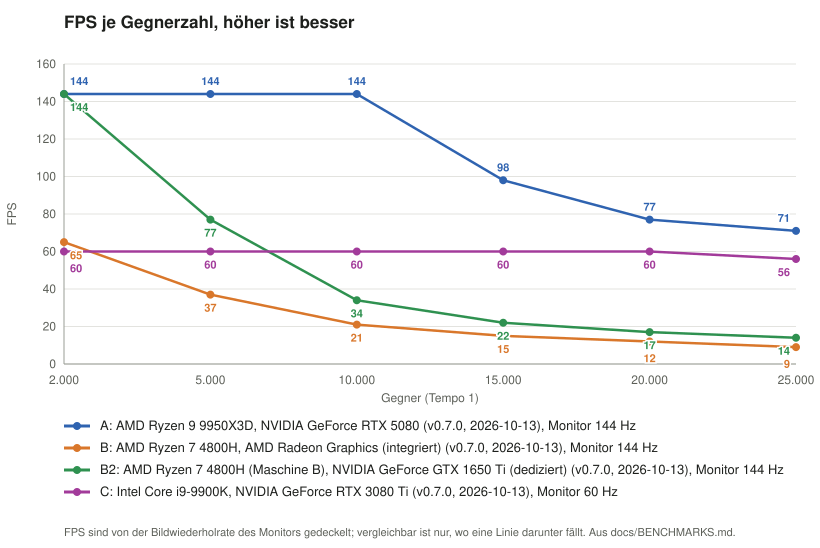
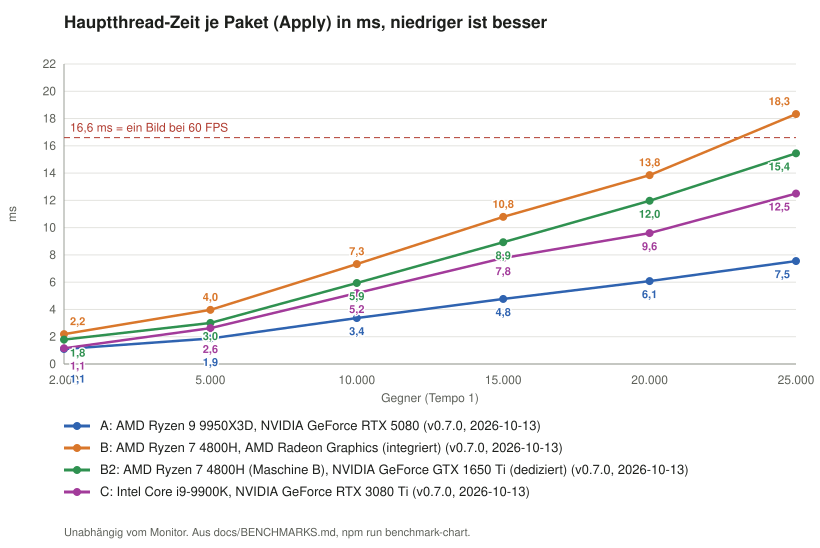

# Benchmark-Ergebnisse je Rechner

**Status:** Laufend gepflegt
**Stand:** 2026-10-13

Ergebnisse des eingebauten Benchmarks (Menü Extras, Benchmark; DevWorld, 40 Tower, Gegner mit 1 000 000 HP, Stufen
2000 bis 25 000 Gegner je bei Tempo 4 und 1, siehe [SIM_WORKER.md](SIM_WORKER.md#kennzahlen)) auf verschiedenen
Rechnern. Messreihen zur Entwicklung der Simulation (Worker, Hebel, Firefox) stehen weiter in
[SIM_WORKER.md](SIM_WORKER.md).

**Neue Messung eintragen:** den kopierten Text des Benchmarks als Abschnitt `### <Datum>, Rechner <Buchstabe>` mit
Code-Block unten anhängen, den Rechner in „Rechner“ ergänzen (CPU von Hand, der Browser kann sie nicht lesen; eine andere GPU derselben Maschine bekommt eine eigene
Kennung wie B2), eine
Zeile in „Übersicht“ nachtragen, dann `npm run benchmark-chart`. GPU so übernehmen, wie der Benchmark sie meldet: das
ist die GPU, auf der wirklich gezeichnet wurde.

## Rechner

| Rechner | CPU | RAM | GPU (gemeldet) | Bildschirm | System |
|---|---|---|---|---|---|
| A | AMD Ryzen 9 9950X3D, 16 Kerne / 32 Threads | 64 GB | NVIDIA GeForce RTX 5080 | 2560 × 1440, 144 Hz, Skalierung 125 % | Windows 11 Pro |
| B (Laptop) | AMD Ryzen 7 4800H, 8 Kerne / 16 Threads, 2,9 GHz | 32 GB | AMD Radeon Graphics (integriert), obwohl eine GTX 1650 Ti (4 GB) verbaut ist | 1920 × 1080, 144 Hz | Windows 11 Pro |
| B2 (Laptop) | AMD Ryzen 7 4800H (Maschine B) | 32 GB | NVIDIA GeForce GTX 1650 Ti (dediziert); 3DTD.exe per Windows-Grafikeinstellung auf „Hohe Leistung“ | 1920 × 1080, 144 Hz | Windows 11 Pro |
| C | Intel Core i9-9900K, 8 Kerne / 16 Threads, 3,6 GHz | 32 GB | NVIDIA GeForce RTX 3080 Ti | 1920 × 1080, Bildrate bei 60 (vermutlich 60 Hz) | Windows 11 Pro |

## Übersicht

FPS bei Tempo 1 (langsamste 5 % in Klammern) und Hauptthread-Zeit je Paket („Apply“) bei 20 000 Gegnern:

| Datum | Rechner | Stand | Laufzeit | 5 000 | 10 000 | 20 000 | ~25 000 | Apply bei 20 000 | Engpass |
|---|---|---|---|---|---|---|---|---|---|
| 2026-10-12 | A | `014f10af`+ (Dev-Stand) | Chrome 154, Fenster, DPR 1,25 | 144 (143) | 143 (143) | 98 (48) | 74 (36) | 8,43 ms | Hauptthread ab 15 000 |
| 2026-10-13 | A | v0.7.0 | Desktop-App (Chromium 152), DPR 1 | 144 (143) | 144 (143) | 77 (48) | 71 (36) | 6,08 ms | Bildrate fällt ab 15 000 vor Apply-Grenze |
| 2026-10-13 | B | v0.7.0 | Desktop-App (Chromium 152), DPR 1 | 37 (36) | 21 (21) | 12 (11) | 9 (9) | 13,85 ms | integrierte GPU ab wenigen tausend |
| 2026-10-13 | B2 | v0.7.0 | Desktop-App (Chromium 152), DPR 1 | 77 (48) | 34 (18) | 17 (16) | 14 (13) | 11,97 ms | GPU ab ~5 000, Hauptthread ab ~15 000 |
| 2026-10-13 | C | v0.7.0 | Desktop-App (Chromium 152), DPR 1 | 60 (60) | 60 (60) | 60 (60) | 56 (30) | 9,60 ms | Hauptthread bei 25 000 |

- **FPS sind vom Monitor gedeckelt** (A 144 Hz, C 60 Hz): C hätte bis 20 000 Gegner vermutlich deutlich mehr geschafft.
  Für den Vergleich der Rechner zählt die Apply-Zeit; künftige Messungen am besten an einem Monitor mit hoher
  Bildwiederholrate.
- Apply wächst linear mit der Gegnerzahl. Unter gleichen Bedingungen (v0.7.0, Desktop-App, DPR 1): A rund 0,3 ms je
  1000 Gegner, C rund 0,5 ms, B 0,75 bis 0,8 ms (TODO E107). A ist bei 25 000 Gegnern 1,65-mal so schnell wie C (7,55
  gegen 12,50 ms). Die ältere A-Messung vom 12.10. (Dev-Stand, DPR 1,25) lag mit 10,39 ms deutlich höher.
- **A fällt ab 15 000 Gegnern unter 144 FPS, obwohl Apply nur 4,8 bis 7,6 ms braucht** (98 FPS = 10,2 ms je Bild bei
  15 000): Ein anderer Teil des Bilds begrenzt dort, nicht das Übernehmen. Ursache nicht untersucht.
- **B rendert ohne Zutun auf der integrierten GPU**, obwohl die Desktop-App `powerPreference: 'high-performance'`
  setzt (PLAYTEST A3.3, Plan E14). Auf der GTX 1650 Ti (B2, 3DTD.exe per Windows-Grafikeinstellung auf „Hohe Leistung“) etwa doppelt so viele FPS: 77 statt 37
  bei 5000 Gegnern, 34 statt 21 bei 10 000. Auch Apply sinkt (3,0 statt 4,0 ms bei 5000, 15,5 statt 18,3 ms bei 25 000):
  ein Teil davon ist Hochladen in die Grafik.
- **B2 ist trotzdem grafikgebunden:** bei 5000 Gegnern 13 ms je Bild, davon 3 ms Apply.

## Charts

Tempo 1, je Rechner die neueste Messung als Linie (ältere stehen nur unten in den Tabellen). Erzeugt aus den Tabellen unter „Messungen“ (`npm run benchmark-chart`, läuft
auch mit `npm test`).





## Bildkosten (Grafik-Benchmark)

Was ein Bild einer Welt kostet, ohne Spiel darauf (E154): Tiles-Orte, eigene Karten und die DevWorld mit denselben
festen Kamerawegen um das HQ (`src/app/benchmark/render-benchmark.ts`), damit „so flüssig wie Tiles“ messbar ist.

- **Ansichten:** `game` die Startansicht des Spiels, `close` 30 m neben dem HQ in 12 m Höhe (Gras, Nahdetails),
  `pan` ein voller Kreis um das HQ im Abstand und in der Höhe der Startansicht, `top` 500 m senkrecht über dem HQ wie
  im Editor. Je Ansicht 2 s Einschwingen (Tiles: bis keine Kachel mehr lädt, höchstens 20 s), dann 5 s Messung.
- **Spalten:** `Frame` mittlerer Abstand der Bilder, `p95` der Abstand, den nur 5 % der Bilder überschreiten, `GPU`
  die GPU-Zeit des Zeichnens je Bild per Timer-Query (`EXT_disjoint_timer_query_webgl2`, `gpu-timer.ts`; Mittel, Median
  `GPU med` und p95; auf einem Rechner, der nebenher arbeitet, hält der Median, wo einzelne lange Bilder das Mittel
  heben), `CPU` Hauptthread-Zeit für Update und Zeichnen, `Calls` und `Triangles` je Bild über alle Durchgänge
  (Schatten, Szene, Nachbearbeitung). Ohne Timer-Query (Firefox, Safari) bleibt die GPU-Spalte leer; dann zählt
  `Frame` bei ungedeckelter Bildrate.
- **Im Spiel:** Menü Extras, „Graphics benchmark“ lädt die Seite mit `benchmark=render` auf derselben Welt neu und
  zeigt am Ende die Tabelle zum Kopieren. Ohne Bildratendeckel (Skript unten) ist `Frame` aussagekräftig, im normalen
  Browser deckelt der Monitor, dann zählt `GPU`.
- **Per Skript** (Nachtschicht, reproduzierbar): Build mit Entwicklungs-Umgebung, aber optimiert (der
  Produktions-Build öffnet eigene Karten per Link erst nach der Freigabe, E134), statisch ausliefern, dann
  `e2e/perf/render-bench.ts`. Das Skript öffnet je Welt und Stufe ein Fenster (sichtbar, ANGLE D3D11, Bildrate
  ungedeckelt), wartet auf `window.__renderBenchmark` und druckt alle Zeilen; den Kartenschlüssel liest es aus
  `src/environments/environment.ts`. `--shots <dir>` legt je Ansicht ein Bild ab (die Aufnahme stört die Messung dieser
  Ansicht etwas, für Ausgangswerte ohne).

```
npx ng build --configuration development --optimization --source-map=false --output-path dist/bench
node e2e/perf/serve.mjs dist/bench/browser 4322 --isolate
node e2e/perf/render-bench.ts --url http://localhost:4322 --worlds map:demo-valley,map:harbor-town,tiles:48.7758,9.1829 [--qualities low,medium,high,ultra]
```

### Ausgangswerte 2026-10-14

Rechner A (RTX 5080), Chromium aus Playwright, Fenster 1600 × 900, Canvas 1300 × 852, DPR 1, Stand `96a5a5aa` plus
Koop-Versand (ohne Einfluss aufs Bild), vor den Qualitätsstufen. Zeiten in ms je Bild.

```
World                 View   Frame  p95   GPU   GPU p95  CPU   Calls  Triangles
map:demo-valley       game   1.32   1.57  1.21  1.55     1.15  290    1.23 M
map:demo-valley       close  0.91   1.17  0.71  1.08     0.75  109    0.94 M
map:demo-valley       pan    1.79   2.19  1.66  2.33     1.12  263    0.97 M
map:demo-valley       top    1.16   1.42  1.03  1.48     1.00  229    0.82 M
map:harbor-town       game   3.43   4.26  2.81  3.77     3.21  1111   1.60 M
map:harbor-town       close  1.74   2.10  1.59  2.16     1.57  251    1.27 M
map:harbor-town       pan    3.84   4.80  3.25  4.15     3.16  1019   1.54 M
map:harbor-town       top    2.98   3.53  2.45  3.10     2.79  893    1.28 M
tiles 48.7758,9.1829  game   0.77   0.93  0.23  0.64     0.60  148    0.37 M
tiles 48.7758,9.1829  close  0.85   1.00  0.31  0.73     0.67  168    0.46 M
tiles 48.7758,9.1829  pan    2.38   2.97  0.78  1.35     1.70  128    0.34 M
tiles 48.7758,9.1829  top    0.59   0.70  0.12  0.30     0.43  91     0.24 M
```

- Die Ausgangslage des Plans ([CUSTOM_MAPS_NEXT_PLAN.md](CUSTOM_MAPS_NEXT_PLAN.md): Tiles 0,88 ms bei 192 Calls,
  Demo-Tal 1,39 ms bei 290, Hafenstadt 4,41 ms bei 1111) war der Bildabstand der Spielansicht ohne Deckel. Das
  Demo-Tal trifft sie (1,32 ms, 290 Calls), die Hafenstadt liegt darunter (3,43 ms, 1111 Calls), Tiles ebenfalls
  (0,77 ms, 148 Calls: wie viele Kacheln stehen, hängt vom Laden ab).
- **Tiles sind auf der GPU billig, eigene Karten nicht:** Tiles 0,23 ms GPU in der Spielansicht, das Demo-Tal 1,21 ms,
  die Hafenstadt 2,81 ms. Beim Schwenk über Tiles wächst der Bildabstand (2,38 ms) bei nur 0,78 ms GPU: dort kostet
  das Nachladen der Kacheln Hauptthread-Zeit.
- **Die Hafenstadt ist auch auf dem Hauptthread teuer:** 3,21 ms CPU bei 1111 Draw Calls, gut fünfmal so viel wie
  Tiles (0,60 ms). Weniger Draw Calls (Modellteile zusammenführen) helfen dort doppelt.

### Je Qualitätsstufe 2026-10-14

Gleiche Bedingungen wie die Ausgangswerte, mit den Qualitätsstufen ([RENDER_QUALITY.md](RENDER_QUALITY.md)), je Stufe
ein Lauf mit `&quality=<level>` (dynamische Auflösung während der Messung festgehalten). Spalten: Bildabstand, GPU, CPU
in ms, Draw Calls; Canvas in Pixeln.

```
World                 Level   View   Frame  GPU   CPU   Calls  Canvas
map:demo-valley       low     game   1.27   1.14  1.08  185    780x511
map:demo-valley       low     pan    1.83   1.38  1.02  167    780x511
map:demo-valley       medium  game   1.60   1.58  1.42  239    1040x681
map:demo-valley       medium  pan    1.82   1.24  1.08  212    1040x681
map:demo-valley       high    game   1.45   1.32  1.23  290    1300x852
map:demo-valley       high    pan    2.02   1.77  1.23  264    1300x852
map:demo-valley       ultra   game   1.55   1.39  1.35  332    1300x852
map:demo-valley       ultra   pan    2.93   2.45  2.11  316    1300x852
map:harbor-town       low     game   2.80   2.32  2.60  834    780x511
map:harbor-town       low     pan    3.27   2.74  2.57  775    780x511
map:harbor-town       medium  game   3.77   3.27  3.54  1055   1040x681
map:harbor-town       medium  pan    4.38   3.71  3.51  949    1040x681
map:harbor-town       high    game   3.68   3.32  3.46  1111   1300x852
map:harbor-town       high    pan    4.12   3.67  3.36  1020   1300x852
map:harbor-town       ultra   game   4.83   4.15  4.56  1173   1300x852
map:harbor-town       ultra   pan    4.38   3.78  3.64  1070   1300x852
tiles 48.7758,9.1829  high    game   0.82   0.45  0.64  153    1300x852
tiles 48.7758,9.1829  high    pan    2.47   0.81  1.78  132    1300x852
tiles 48.7758,9.1829  low     game   0.86   0.32  0.68  161    780x511
tiles 48.7758,9.1829  low     pan    2.87   1.04  2.09  143    780x511
```

- **Auf der RTX 5080 bei DPR 1 zählen die Draw Calls, nicht die Pixel:** GPU- und CPU-Zeit liegen bei eigenen Karten
  fast gleich auf (die Timer-Query misst auch, wie lange die GPU auf die Befehle wartet). Low spart in der Hafenstadt
  über weniger Objekte (834 statt 1111 Calls) 24 % Bildzeit; Medium liegt im Rauschen von High (zwischen zwei Läufen
  derselben Stufe schwanken die Zeiten um 0,1 bis 0,3 ms); Ultra kostet bis 30 % (Demo-Tal 2,45 statt 1,77 ms GPU
  beim Schwenk).
- **Tiles in High wie vorher:** 0,82 ms und 153 Calls gegen 0,77 ms und 148 in den Ausgangswerten (Kacheln laden je
  Lauf etwas anders).
- **Wo die Pixel zählen** (schwache GPUs), zeigt eine Software-GPU (`--angle swiftshader`, Fenster 1000 × 600, Demo-Tal,
  Spielansicht): GPU-Zeit je Bild Low 689 ms, Medium 695 ms, High 2561 ms. Low und Medium kosten dort gut ein Viertel
  von High; ein bis zwei Bilder je Sekunde, nur als Richtung.

### Je Qualitätsstufe nach den Draw Calls und KTX2 (2026-10-14)

Gleiche Bedingungen, nach dem Packen kleiner Assets, dem Zusammenlegen von Modellteilen, den KTX2-Bodenmaterialien
und dem weichen Stufenwechsel. `GPU med` ist der Median der GPU-Zeit je Bild; der Rechner arbeitete nebenher (andere
Worker bauten und testeten), zwischen zwei Läufen derselben Stufe streuen die Werte um 0,1 bis 0,3 ms.

```
World            Level   View   Frame  GPU med  Calls  Canvas
map:demo-valley  low     game    0.85     0.72    101  780x511
map:demo-valley  low     pan     1.51     1.02    101  780x511
map:demo-valley  medium  game    0.99     0.75    139  1040x681
map:demo-valley  medium  pan     1.60     1.18    141  1040x681
map:demo-valley  high    game    1.21     0.96    168  1300x852
map:demo-valley  high    pan     1.72     1.45    178  1300x852
map:demo-valley  ultra   game    1.19     1.12    185  1300x852
map:demo-valley  ultra   pan     2.71     1.68    212  1300x852
map:harbor-town  low     game    1.01     0.58     94  780x511
map:harbor-town  low     pan     1.47     1.00    101  780x511
map:harbor-town  medium  game    1.19     0.65    112  1040x681
map:harbor-town  medium  pan     1.74     0.72    119  1040x681
map:harbor-town  high    game    1.17     0.95    120  1300x852
map:harbor-town  high    pan     1.73     1.41    129  1300x852
map:harbor-town  ultra   game    1.57     1.20    165  1300x852
map:harbor-town  ultra   pan     2.22     1.89    180  1300x852
```

- **High gegen die Ausgangswerte:** Hafenstadt 3,68 → 1,17 ms Bildabstand bei 1111 → 120 Calls, Demo-Tal 1,45 →
  1,21 ms bei 290 → 168.
- **Medium und Low** liegen in der Spielansicht 20 bis 40 % unter High (GPU med); Low kaum unter Medium, die
  Auflösung bindet auf der RTX 5080 nicht mehr.
- **Ultra in der Spielansicht bei DPR 1** 1,17- bis 1,26-mal High (Demo-Tal 1,12 gegen 0,96 ms, Hafenstadt 1,20
  gegen 0,95). Getrennt gemessen (Demo-Tal, je eine Stellschraube von Ultra auf High-Wert, Spielansicht, GPU med):
  Ultra 1,14, Gras nur bis High-Weite 1,13, Schatten wie High 1,13, Impostoren und Objektweite wie High 1,12 ms (Calls
  185 → 168), alle drei 0,97 ms, High 1,11 ms; keine der Stellschrauben allein trägt den Abstand, er liegt im
  Rauschen der Einzelläufe. Ein Lauf vor dem Rebase auf den Stand mit dem Editor-Paket hatte im Demo-Tal Ultra 5,09
  gegen High 0,92 ms gemessen; auf dem neuen Stand ist das nicht mehr nachzustellen, die Ursache ist nicht belegt.
- **Bei DPR 2** (`--dpr 2`, Demo-Tal) deckelt High die Auflösung bei 1,5 (1950 × 1278), Ultra bei 2 (2600 × 1704,
  1,78-mal so viele Pixel): Spielansicht GPU med High 1,79, Ultra 3,12 ms (1,74-mal); Draufsicht 1,50 gegen 4,47 ms
  (3-mal), dort zählen die Pixel. Ultra bleibt eine Stufe nur von Hand; die Werte bleiben.

### Ruhiger Rechner 2026-10-15: Schattenbox, 12 Schichten, Bildhimmel

Rechner A (RTX 5080) ohne andere Last (CPU 7 bis 10 %), sonst gleiche Bedingungen. Builds mit Entwicklungs-Umgebung,
optimiert, `3cb4c594` (vor der Schattenbox nach sichtbarem Boden, den 12 Bodenschichten und den Bildhimmeln) gegen
`67e3fe51`. `GPU med` in ms, Draw Calls.

```
World            Level  View    3cb4c594        67e3fe51
                                GPU med  Calls  GPU med  Calls
map:demo-valley  high   game    0.76     160    0.75     160
map:demo-valley  high   close   0.61      96    0.67      96
map:demo-valley  high   pan     1.38     182    1.05     155
map:demo-valley  high   top     0.63     141    0.62     141
map:demo-valley  low    game    0.54      95    0.53      95
map:demo-valley  low    close   0.51      99    0.52      99
map:demo-valley  low    pan     0.98     104    0.91      96
map:harbor-town  high   game    0.88     121    0.85     121
map:harbor-town  high   close   1.02     140    1.02     140
map:harbor-town  high   pan     1.41     132    1.28     127
map:harbor-town  low    game    0.58      92    0.51      92
map:harbor-town  low    pan     1.11     102    1.09     100
```

- **Schattenbox** (über dem gesehenen Boden, über vier Bilder verteilt): beim Schwenk High im Demo-Tal 1,38 → 1,05 ms
  (27 Calls weniger), in der Hafenstadt 1,41 → 1,28; Low kaum (0,98 → 0,91, 1,11 → 1,09). Spielansicht, Nähe und
  Draufsicht gleich (±0,06 ms, Rauschen der Einzelläufe).
- **12 Bodenschichten:** das Demo-Tal mit vier Schichten mehr (Schichten 1 bis 4 je zur Hälfte in 9 bis 12, die dritte
  Splat-Karte zeichnet überall) kostet in der Spielansicht 0,87 statt 0,75 ms, nah 0,78 statt 0,67, Schwenk 1,08 statt
  1,05 ms: rund 0,1 ms für die dritte Karte, nur auf Karten mit mehr als 8 Schichten (Karten bis 8 nutzen das alte
  Programm, oben unverändert).
- **Bildhimmel** (Demo-Tal mit `fair-weather`, 4096 Pixel breit): 0,76 / 0,59 / 1,06 / 0,62 ms in Spiel, Nähe, Schwenk,
  Draufsicht gegen 0,75 / 0,67 / 1,05 / 0,62 mit der prozeduralen Kuppel: kein messbarer Unterschied.

### Eigene Karten und Szenenkosten 2026-10-15

Gleicher Lauf, Stufe High, `67e3fe51`; die neuen Karten aus den Editor-Vorlagen (Saat 1, Zellen 2 m) als mitgelieferte
Karten nur in den Bench-Build gelegt. Eichung von `SCENE_BUDGET` ([LEVEL_EDITOR.md](LEVEL_EDITOR.md), „Szenenkosten“).

```
World                   Points  Cost   game GPU med  worst view       Calls  Triangles
map:moon-base           2.44 M   20 %  0.41          0.80 pan          78    0.77 M
map:autumn-keep         2.81 M   23 %  0.53          1.06 close        85    0.31 M
map:demo-valley         1.96 M   16 %  0.75          1.03 pan         160    0.92 M
map:harbor-town         2.54 M   21 %  0.85          1.28 pan         121    1.46 M
map:ruined-city         7.47 M   62 %  0.92          1.42 close        89    2.42 M
new Meadows Large       0.51 M    4 %  0.86          1.11 pan         203    0.91 M
new Hell Medium         1.25 M   10 %  1.12          1.27 pan         203    0.94 M
new Woods Large         6.36 M   53 %  1.86          3.40 close       598    1.14 M
new City Medium        12.04 M  100 %  2.40          3.05 close       214    8.18 M
```

- Gerade durch alle neun (kleinste Quadrate): teuerste Ansicht 0,81 ms + 0,19 ms je Mio. Punkte, Spielansicht
  0,51 + 0,14 ms (R² 0,62). Bei 3 ms in der teuersten Ansicht liegen 11,5 Mio.: `SCENE_BUDGET` bleibt 12 Mio.,
  jetzt gemessen statt geschätzt.
- Der Sockel ist Gelände, Gras, Wasser und Licht, nicht Objekte: die Large-Wiese (91 500 Objekte, 4 %) kostet so viel
  wie die Hafenstadt. Über der Geraden liegt der Large-Wald (598 Calls).

### Steile Hänge, Kartenrand, Baumvielfalt (2026-10-15)

Rechner A (RTX 5080), Canvas 1300 × 852 (Low 780 × 511), Skript ohne sichtbares Fenster (headless, ANGLE D3D11, mit
Timer-Query), Stand `26348b25` gegen denselben mit den Seitenebenen steiler gemalter Hänge, dem Rand (Bemalung,
Bergkette, gespiegelte Bäume) und der Baumvielfalt; GPU-Median in ms, Draw Calls gleich in allen Zeilen:

```
map              stufe  game         close        pan          top
mountain-pass    high   0.84 → 0.85  1.21 → 0.97  1.22 → 1.11  0.66 → 0.67
mountain-pass    low    0.59 → 0.57  0.58 → 0.59  0.67 → 0.61  0.46 → 0.46
autumn-keep      high   0.66 → 0.67  1.28 → 1.26  0.81 → 0.70  0.66 → 0.66
autumn-keep      low    0.47 → 0.47  0.76 → 0.76  0.49 → 0.46  0.46 → 0.46
harbor-town      low    1.37 → 0.61  0.81 → 0.80  1.15 → 0.65  0.62 → 0.58
```

Kein messbarer Mehraufwand; Abnahmen wie 1,21 → 0,97 liegen im Rauschen eines Rechners, auf dem nebenher gearbeitet
wurde. Harbor Town High fehlt: der Vorher-Lauf war gestört (3,2 bis 4,9 ms in allen Ansichten). Die Ansichten
kreisen um das HQ und sehen den Rand kaum; in einer Ansicht auf den Rand von Mountain Pass zeichnet die Schicht der
gespiegelten Bäume 9 Instanz-Meshes mehr (Calls +9).

## Messungen

### 2026-10-12, Rechner A

Stand `014f10af` mit Änderungen im Arbeitsbaum, Chrome 154 im normalen Fenster. Übertragen aus der Tabelle in
[SIM_WORKER.md](SIM_WORKER.md#benchmark-im-spiel-bis-25-000-gegner-gemessen-2026-10-12); dort nicht genannte Felder als `-`.

```
Version  Commit     Browser     OS       Threads  Memory  GPU                      DPR   Viewport  Enemies  Speed  FPS  p05  Reached  Ticks/s  Worker  Apply/packet
dev      014f10af+  Chrome 154  Windows  -        -       NVIDIA GeForce RTX 5080  1.25  2048x983  2000     4x     144  143  -        30       8 %     1.28 ms
dev      014f10af+  Chrome 154  Windows  -        -       NVIDIA GeForce RTX 5080  1.25  2048x983  2000     1x     144  143  -        30       3 %     1.19 ms
dev      014f10af+  Chrome 154  Windows  -        -       NVIDIA GeForce RTX 5080  1.25  2048x983  5000     4x     144  144  -        30       12 %    2.17 ms
dev      014f10af+  Chrome 154  Windows  -        -       NVIDIA GeForce RTX 5080  1.25  2048x983  5000     1x     144  143  -        30       5 %     2.18 ms
dev      014f10af+  Chrome 154  Windows  -        -       NVIDIA GeForce RTX 5080  1.25  2048x983  10000    4x     144  142  -        30       25 %    4.22 ms
dev      014f10af+  Chrome 154  Windows  -        -       NVIDIA GeForce RTX 5080  1.25  2048x983  10000    1x     143  143  -        30       10 %    4.04 ms
dev      014f10af+  Chrome 154  Windows  -        -       NVIDIA GeForce RTX 5080  1.25  2048x983  15000    4x     126  72   -        30       36 %    7.62 ms
dev      014f10af+  Chrome 154  Windows  -        -       NVIDIA GeForce RTX 5080  1.25  2048x983  15000    1x     127  72   -        30       14 %    6.59 ms
dev      014f10af+  Chrome 154  Windows  -        -       NVIDIA GeForce RTX 5080  1.25  2048x983  20000    4x     97   48   -        30       51 %    10.22 ms
dev      014f10af+  Chrome 154  Windows  -        -       NVIDIA GeForce RTX 5080  1.25  2048x983  20000    1x     98   48   -        30       20 %    8.43 ms
dev      014f10af+  Chrome 154  Windows  -        -       NVIDIA GeForce RTX 5080  1.25  2048x983  24920    4x     73   36   -        30       63 %    12.80 ms
dev      014f10af+  Chrome 154  Windows  -        -       NVIDIA GeForce RTX 5080  1.25  2048x983  24920    1x     74   36   -        30       25 %    10.39 ms
```

### 2026-10-13, Rechner A

Desktop-App v0.7.0, Fenster 1920 × 1080, DPR 1: gleiche Bedingungen wie B und C.

```
Version  Commit    Browser     OS       Threads  Memory  GPU                      DPR  Viewport   Enemies  Speed  FPS  p05  Reached  Ticks/s  Worker  Apply/packet
v0.7.0   08364a7+  Chrome 152  Windows  32       32 GB   NVIDIA GeForce RTX 5080  1    1920x1080  2001     4x     144  143  3.99     30       8 %     1.16 ms
v0.7.0   08364a7+  Chrome 152  Windows  32       32 GB   NVIDIA GeForce RTX 5080  1    1920x1080  2000     1x     144  143  1.00     30       3 %     1.10 ms
v0.7.0   08364a7+  Chrome 152  Windows  32       32 GB   NVIDIA GeForce RTX 5080  1    1920x1080  5000     4x     144  143  3.99     30       12 %    1.98 ms
v0.7.0   08364a7+  Chrome 152  Windows  32       32 GB   NVIDIA GeForce RTX 5080  1    1920x1080  5000     1x     144  143  1.00     30       5 %     1.87 ms
v0.7.0   08364a7+  Chrome 152  Windows  32       32 GB   NVIDIA GeForce RTX 5080  1    1920x1080  10000    4x     144  143  3.97     30       22 %    3.64 ms
v0.7.0   08364a7+  Chrome 152  Windows  32       32 GB   NVIDIA GeForce RTX 5080  1    1920x1080  10000    1x     144  143  1.00     30       9 %     3.37 ms
v0.7.0   08364a7+  Chrome 152  Windows  32       32 GB   NVIDIA GeForce RTX 5080  1    1920x1080  15000    4x     126  72   3.98     30       34 %    6.15 ms
v0.7.0   08364a7+  Chrome 152  Windows  32       32 GB   NVIDIA GeForce RTX 5080  1    1920x1080  15000    1x     98   72   0.99     30       11 %    4.77 ms
v0.7.0   08364a7+  Chrome 152  Windows  32       32 GB   NVIDIA GeForce RTX 5080  1    1920x1080  20000    4x     77   48   3.97     30       36 %    6.46 ms
v0.7.0   08364a7+  Chrome 152  Windows  32       32 GB   NVIDIA GeForce RTX 5080  1    1920x1080  20000    1x     77   48   1.00     30       15 %    6.08 ms
v0.7.0   08364a7+  Chrome 152  Windows  32       32 GB   NVIDIA GeForce RTX 5080  1    1920x1080  24920    4x     72   36   3.99     30       48 %    8.00 ms
v0.7.0   08364a7+  Chrome 152  Windows  32       32 GB   NVIDIA GeForce RTX 5080  1    1920x1080  24840    1x     71   36   1.00     30       19 %    7.55 ms
```

### 2026-10-13, Rechner B

```
Version  Commit    Browser     OS       Threads  Memory  GPU                      DPR  Viewport   Enemies  Speed  FPS  p05  Reached  Ticks/s  Worker  Apply/packet
v0.7.0   08364a7+  Chrome 152  Windows  16       32 GB   AMD Radeon(TM) Graphics  1    1920x1080  2001     4x     65   48   3.98     30       20 %    2.39 ms
v0.7.0   08364a7+  Chrome 152  Windows  16       32 GB   AMD Radeon(TM) Graphics  1    1920x1080  2000     1x     65   48   1.00     30       6 %     2.19 ms
v0.7.0   08364a7+  Chrome 152  Windows  16       32 GB   AMD Radeon(TM) Graphics  1    1920x1080  5000     4x     36   36   3.97     30       29 %    4.46 ms
v0.7.0   08364a7+  Chrome 152  Windows  16       32 GB   AMD Radeon(TM) Graphics  1    1920x1080  5000     1x     37   36   0.99     30       9 %     3.97 ms
v0.7.0   08364a7+  Chrome 152  Windows  16       32 GB   AMD Radeon(TM) Graphics  1    1920x1080  10000    4x     20   18   3.98     20       44 %    7.78 ms
v0.7.0   08364a7+  Chrome 152  Windows  16       32 GB   AMD Radeon(TM) Graphics  1    1920x1080  10000    1x     21   21   1.00     21       15 %    7.33 ms
v0.7.0   08364a7+  Chrome 152  Windows  16       32 GB   AMD Radeon(TM) Graphics  1    1920x1080  15000    4x     15   14   3.97     15       63 %    11.87 ms
v0.7.0   08364a7+  Chrome 152  Windows  16       32 GB   AMD Radeon(TM) Graphics  1    1920x1080  15000    1x     15   14   0.99     15       20 %    10.79 ms
v0.7.0   08364a7+  Chrome 152  Windows  16       32 GB   AMD Radeon(TM) Graphics  1    1920x1080  20000    4x     11   11   3.96     12       77 %    15.72 ms
v0.7.0   08364a7+  Chrome 152  Windows  16       32 GB   AMD Radeon(TM) Graphics  1    1920x1080  20000    1x     12   11   0.99     12       23 %    13.85 ms
v0.7.0   08364a7+  Chrome 152  Windows  16       32 GB   AMD Radeon(TM) Graphics  1    1920x1080  24920    4x     9    9    3.95     11       92 %    20.19 ms
v0.7.0   08364a7+  Chrome 152  Windows  16       32 GB   AMD Radeon(TM) Graphics  1    1920x1080  24840    1x     9    9    0.99     10       27 %    18.33 ms
```

### 2026-10-13, Rechner B2

Derselbe Laptop wie B, die 3DTD.exe per Windows-Grafikeinstellung auf „Hohe Leistung“, also die GTX 1650 Ti.

```
Version  Commit    Browser     OS       Threads  Memory  GPU                         DPR  Viewport   Enemies  Speed  FPS  p05  Reached  Ticks/s  Worker  Apply/packet
v0.7.0   08364a7+  Chrome 152  Windows  16       32 GB   NVIDIA GeForce GTX 1650 Ti  1    1920x1080  2001     4x     144  141  3.97     30       17 %    1.80 ms
v0.7.0   08364a7+  Chrome 152  Windows  16       32 GB   NVIDIA GeForce GTX 1650 Ti  1    1920x1080  2000     1x     144  139  1.00     30       5 %     1.79 ms
v0.7.0   08364a7+  Chrome 152  Windows  16       32 GB   NVIDIA GeForce GTX 1650 Ti  1    1920x1080  5000     4x     76   48   3.98     30       26 %    3.35 ms
v0.7.0   08364a7+  Chrome 152  Windows  16       32 GB   NVIDIA GeForce GTX 1650 Ti  1    1920x1080  5000     1x     77   48   0.99     30       9 %     3.01 ms
v0.7.0   08364a7+  Chrome 152  Windows  16       32 GB   NVIDIA GeForce GTX 1650 Ti  1    1920x1080  10000    4x     32   21   4.00     30       43 %    6.31 ms
v0.7.0   08364a7+  Chrome 152  Windows  16       32 GB   NVIDIA GeForce GTX 1650 Ti  1    1920x1080  10000    1x     34   18   1.00     27       14 %    5.94 ms
v0.7.0   08364a7+  Chrome 152  Windows  16       32 GB   NVIDIA GeForce GTX 1650 Ti  1    1920x1080  15000    4x     22   21   3.98     22       61 %    9.73 ms
v0.7.0   08364a7+  Chrome 152  Windows  16       32 GB   NVIDIA GeForce GTX 1650 Ti  1    1920x1080  15000    1x     22   21   1.00     22       21 %    8.93 ms
v0.7.0   08364a7+  Chrome 152  Windows  16       32 GB   NVIDIA GeForce GTX 1650 Ti  1    1920x1080  20000    4x     17   16   3.97     17       75 %    13.31 ms
v0.7.0   08364a7+  Chrome 152  Windows  16       32 GB   NVIDIA GeForce GTX 1650 Ti  1    1920x1080  20000    1x     17   16   0.99     17       23 %    11.97 ms
v0.7.0   08364a7+  Chrome 152  Windows  16       32 GB   NVIDIA GeForce GTX 1650 Ti  1    1920x1080  24920    4x     14   13   3.97     14       86 %    17.14 ms
v0.7.0   08364a7+  Chrome 152  Windows  16       32 GB   NVIDIA GeForce GTX 1650 Ti  1    1920x1080  24840    1x     14   13   0.99     14       27 %    15.45 ms
```

### 2026-10-13, Rechner C

```
Version  Commit    Browser     OS       Threads  Memory  GPU                         DPR  Viewport   Enemies  Speed  FPS  p05  Reached  Ticks/s  Worker  Apply/packet
v0.7.0   08364a7+  Chrome 152  Windows  16       32 GB   NVIDIA GeForce RTX 3080 Ti  1    1920x1080  2001     4x     60   60   3.99     30       9 %     1.32 ms
v0.7.0   08364a7+  Chrome 152  Windows  16       32 GB   NVIDIA GeForce RTX 3080 Ti  1    1920x1080  2000     1x     60   60   1.00     30       3 %     1.15 ms
v0.7.0   08364a7+  Chrome 152  Windows  16       32 GB   NVIDIA GeForce RTX 3080 Ti  1    1920x1080  5000     4x     60   60   3.99     30       16 %    2.83 ms
v0.7.0   08364a7+  Chrome 152  Windows  16       32 GB   NVIDIA GeForce RTX 3080 Ti  1    1920x1080  5000     1x     60   60   0.99     30       6 %     2.63 ms
v0.7.0   08364a7+  Chrome 152  Windows  16       32 GB   NVIDIA GeForce RTX 3080 Ti  1    1920x1080  10000    4x     60   60   3.98     30       29 %    5.42 ms
v0.7.0   08364a7+  Chrome 152  Windows  16       32 GB   NVIDIA GeForce RTX 3080 Ti  1    1920x1080  10000    1x     60   60   1.00     30       11 %    5.20 ms
v0.7.0   08364a7+  Chrome 152  Windows  16       32 GB   NVIDIA GeForce RTX 3080 Ti  1    1920x1080  15000    4x     60   60   3.98     30       44 %    8.07 ms
v0.7.0   08364a7+  Chrome 152  Windows  16       32 GB   NVIDIA GeForce RTX 3080 Ti  1    1920x1080  15000    1x     60   60   1.00     30       17 %    7.77 ms
v0.7.0   08364a7+  Chrome 152  Windows  16       32 GB   NVIDIA GeForce RTX 3080 Ti  1    1920x1080  20000    4x     60   60   3.98     30       58 %    10.59 ms
v0.7.0   08364a7+  Chrome 152  Windows  16       32 GB   NVIDIA GeForce RTX 3080 Ti  1    1920x1080  20000    1x     60   60   1.00     30       22 %    9.60 ms
v0.7.0   08364a7+  Chrome 152  Windows  16       32 GB   NVIDIA GeForce RTX 3080 Ti  1    1920x1080  24920    4x     51   30   3.98     30       71 %    13.05 ms
v0.7.0   08364a7+  Chrome 152  Windows  16       32 GB   NVIDIA GeForce RTX 3080 Ti  1    1920x1080  24920    1x     56   30   1.00     30       28 %    12.50 ms
```

Beide Läufe in der Desktop-App; „Chrome 152“ ist die Chromium-Version der App.
